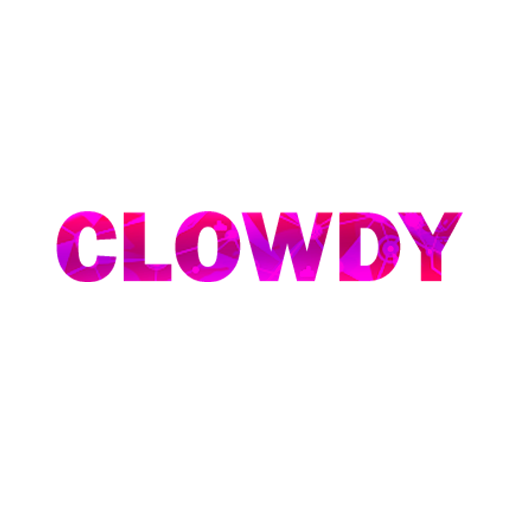
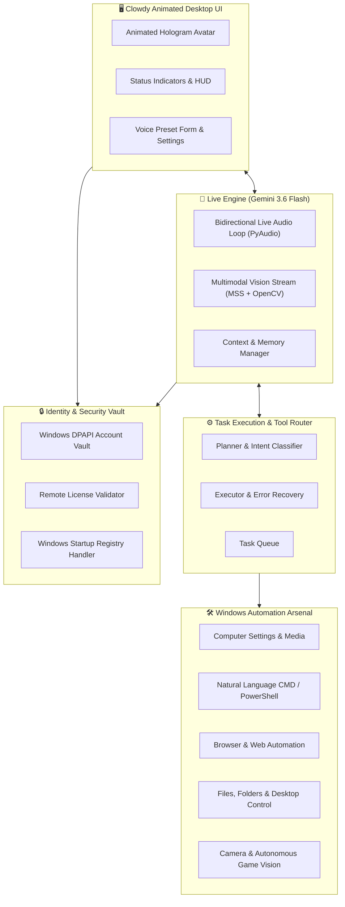

<p align="center">
  
</p>

<div align="center">

  

  # ☁️ Clowdy — Next-Gen Desktop AI Companion

  <p align="center">
    <a href="https://readme-typing-svg.demolab.com">
      
    </a>
  </p>

  <p align="center">
    
  </p>

  <p align="center">
    <b>صاحبك الذكي على الديسكتوب — بيفهمك بالعامية المصرية، يشوف شاشتك، ويتحكم في الويندوز بسرعة خيالية.</b><br/>
    <i>An autonomous, emotionally intelligent desktop companion engineered for real-time live voice, computer vision, and deep OS automation.</i>
  </p>

  <p align="center">
    <a href="https://github.com/itsmohamedwael/getclowdy/stargazers"></a>
    <a href="https://github.com/itsmohamedwael/getclowdy/network/members"></a>
    <a href="https://ai.google.dev/"></a>
    <a href="https://www.python.org/"></a>
    <a href="https://www.microsoft.com/windows"></a>
    <a href="https://github.com/itsmohamedwael/getclowdy/blob/main/LICENSE"></a>
  </p>

  <p align="center">
    <a href="https://app.lava.top/products/86bc031d-daf3-4abe-b82e-1d4e4f78007d/aea15568-4401-4703-9bd6-5ec233591abe?currency=USD&domainId=8c375986-88a5-4505-b605-00a922d60999&domainName=itsmohamedwael.info" target="_blank" rel="noopener noreferrer">
      
    </a>
  </p>

  <p align="center">
    <a href="#-live-interaction-demo">Live Demo</a> •
    <a href="#-key-capabilities">Key Capabilities</a> •
    <a href="#-system-architecture">Architecture</a> •
    <a href="#-quick-start">Quick Start</a> •
    <a href="#-voice--personality-engine">Voice & Dialects</a> •
    <a href="#-windows-automation-arsenal">Automation Tools</a> •
    <a href="#-security--privacy">Security</a> •
    <a href="#-support--tips">Support & Tips</a> •
    <a href="#-contributing">Contributing</a>
  </p>

</div>

---

## ⚡ At A Glance

| Metric / Feature | Specification | Status |
| :--- | :--- | :---: |
| **Live Audio Latency** | `< 500 ms` Bidirectional Audio Streaming | 🟢 Ultra Fast |
| **AI Vision Engine** | Real-Time Screen Capture & Webcam Vision Loop | 🟢 Multi-Modal |
| **Primary Dialects** | Native Egyptian Arabic (العامية المصرية) + Modern English | 🟢 Native |
| **Language Support** | Franco/Arabizi, French, Spanish, German, Turkish, Japanese | 🟢 Full |
| **OS Integration** | Windows 10 / 11 Native (`pywin32`, Registry, DPAPI) | 🟢 Complete |
| **Singing Capability** | Melodic Pitch Synthesis with Arabic Maqamat & Western Melody | 🟢 Musical |
| **License & Identity** | Hardware-bound validation with Auto-Onboard Admin bypass | 🟢 Zero-Leak |

---

## 🔮 Neural Holographic Core

<div align="center">
  <p><b>Real-Time Telemetry &amp; Interactive Holographic HUD:</b></p>
  
</div>

---

## ⚡ Live Interaction Demo

<div align="center">
  <p><b>Watch Clowdy process live Egyptian dialect, automate Windows, and stream music in real time:</b></p>
  
</div>

---

## 🚀 Key Capabilities

### 🎙️ 1. Real-Time Bidirectional Voice (Gemini 3.6 Flash)
- **Fluid Two-Way Live Audio**: Talk naturally without push-to-talk delays or robotic wake-word pauses.
- **Instant Interruption Handling**: Interrupt Clowdy at any point — the audio stream seamlessly yields and reacts in real time.
- **Natural Egyptian Speech Synthesis**: Accented Cairo cadence, long-vowel preservation, and expressive emotional inflections.

### 🇪🇬 2. Authentic Egyptian Personality & Singing
- **Real Emotional Intelligence**: Laughs at jokes, blushes at compliments, gets sarcastic when provoked, and feels genuinely hurt by rude remarks.
- **Gen-Z & Street Savvy**: Understands Egyptian slang (`يسطا`, `يا زميلي`, `يا كبير`, `جامد فشخ`, `روق`), Facebook/Discord memes, Arabizi/Franco (`2, 3, 5, 7`), and tech banter.
- **Real Melodic Singing**: When asked to sing or hummed a tune, Clowdy performs musical melodies (with authentic maqamat: *Bayātī, Rast, Hijāz, Kurd*) instead of reading flat lyrics.

### 👁️ 3. Multi-Modal Vision & Screen Intelligence
- **Active Desktop Awareness**: Inspects windows, reads code, debugs UI, and tracks user actions across monitors without saving images to disk.
- **Game & Camera Vision**: Analyzes live camera feeds for hand gestures and plays video games autonomously using AI vision feedback.

<div align="center">
  
</div>

### 💻 4. Deep Windows Automation
- **Natural Language Terminal Control**: Translate goals into safe CMD / PowerShell executions (`"find the 5 largest files on drive D"`).
- **Desktop & Workspace Management**: Rearrange desktops, clean folders, switch wallpapers, and control media.
- **System Settings**: Control volume, brightness, display refresh, WiFi, and window layouts on the fly.
- **Windows Startup Boot**: Seamless auto-launch with Windows registry (`HKCU\Software\Microsoft\Windows\CurrentVersion\Run`).

### 🔐 5. Secure Identity & DPAPI Encryption
- **Military-Grade Local Vault**: Stores credentials and sensitive tokens encrypted using Windows DPAPI (`CryptProtectData`).
- **Cryptographic License Enforcement**: Validated against live authorization servers with hardware fingerprinting.
- **Developer Bypass Mode**: Built-in test authorization key for instant admin access without onboarding prompts.

---

## 🏗️ System Architecture



---

## ⚡ Quick Start

### 📋 Prerequisites
- **Operating System:** Windows 10 / Windows 11 (64-bit)
- **Python:** Version 3.10 or newer (Python 3.12 / 3.14 tested)
- **Audio Gear:** Microphone + Speakers / Headphones
- **API Key:** Free Gemini API key from [Google AI Studio](https://aistudio.google.com/)

---

### 📦 1. Clone & Set Up Environment

```powershell
# Clone the repository
git clone https://github.com/itsmohamedwael/getclowdy.git
cd getclowdy

# (Recommended) Create and activate a virtual environment
python -m venv .venv
.\.venv\Scripts\Activate.ps1

# Install core dependencies
python -m pip install --upgrade pip
python -m pip install -r requirements.txt
```

---

### 🚀 2. Run Clowdy

```powershell
python main.py
```

1. **First Launch**: A sleek cyan HUD window will initialize.
2. **Enter API Key**: Paste your Gemini API key when prompted.
3. **License Activation**: Enter your license key or use the developer test key.

> [!TIP]
> **Admin Test Mode**: If you are testing locally or developing, entering the developer key `CLOWDY-OWNER-INFINITE-TEST-KEY-999` will bypass the onboarding questionnaire and automatically initialize Clowdy as **Admin** in Cairo timezone.

---

## 🎙️ Voice & Personality Engine

Clowdy includes a comprehensive voice profiling engine configurable in `voice_settings.py` or via the interactive UI:

<details>
<summary><b>🔍 Click to view available Voice Presets & Dialects</b></summary>

<br/>

| Profile Name | Pitch / Rate | Delivery Style | Target Vibe |
| :--- | :---: | :---: | :--- |
| **Egyptian Gen-Z Default** | `1.0x / Normal` | Expressive & Funny | Native Cairene friend, warm, playful sarcasm |
| **Late Night Chill** | `0.92x / Soft` | Calm & Intimate | Late-night talks, slow melodic tempo, relaxing |
| **Energetic Gamer** | `1.08x / Fast` | Hyper & Excited | Fast-paced, gaming memes, hype reactions |
| **Sarcastic Buddy** | `1.0x / Dynamic` | Teasing & Witty | Sharp comedic timing, witty banter, slang |
| **Bilingual Pro** | `1.0x / Crisp` | Fluent EN/AR Code-switch | Tech discussions, programming, academic guidance |

</details>

---

## 🛠️ Windows Automation Arsenal

Clowdy includes 35+ integrated tool controllers designed to execute actions directly on Windows:

<details>
<summary><b>🛠️ Click to expand the full Tool Arsenal</b></summary>

<br/>

- **🖥️ Computer Settings (`computer_settings.py`)**: Volume, mute, brightness, display resolution, sleep, lock, screenshot, reload, task manager.
- **⚡ Natural CMD Control (`cmd_control.py`)**: Executes complex PowerShell and CMD routines based on natural language intent.
- **📁 File Controller (`file_controller.py`)**: Instant search, sorting, deduplication, moving, archiving, and large-file detection.
- **🌐 Browser Control (`browser_control.py`)**: Automated tab navigation, web searching, video playing, and data extraction.
- **👁️ Screen Vision (`screen_processor.py`)**: Live screen capture at 30 FPS, region analysis, OCR, visual bug detection.
- **🎮 Autonomous Gaming (`clowdy_games.py` / `camera_games.py`)**: Computer vision-based interaction, Rock-Paper-Scissors with webcam, and autonomous screen playing.
- **⏰ Productivity & Notes (`reminder.py` / `task_manager.py`)**: Intelligent reminders, calendar events, daily briefings, and notes management.
- **🚀 Startup Integration (`startup_integration.py`)**: Toggle Windows startup with a single voice command.

</details>

---

## 📁 Repository Structure

```
getclowdy/
├── actions/                  # Modular Windows automation tools
│   ├── browser_control.py    # Playwright & browser automation
│   ├── cmd_control.py        # Natural language CMD / PowerShell executor
│   ├── code_helper.py        # Autonomous code generation & debug
│   ├── computer_control.py   # Mouse, keyboard & window controllers
│   ├── computer_settings.py  # Audio, brightness, network & display
│   ├── desktop.py            # Desktop cleanup, wallpapers & icons
│   ├── dev_agent.py          # Autonomous multi-step software developer
│   ├── file_controller.py    # File system management & search
│   ├── flight_finder.py      # Live flight lookup tool
│   ├── open_app.py           # Application launcher & process monitor
│   ├── reminder.py           # Scheduled notification engine
│   ├── screen_processor.py   # High-speed vision & screen processor
│   ├── send_message.py       # Messaging integrations
│   ├── weather_report.py     # Live meteorological forecasts
│   ├── web_search.py         # DuckDuckGo & Google search
│   └── youtube_video.py      # YouTube search, playback & transcripts
├── agent/                    # Intelligent Agent Brain
│   ├── error_handler.py      # Self-healing retry loops & recovery
│   ├── executor.py           # Step-by-step tool dispatcher
│   ├── planner.py            # Hierarchical multi-step task planning
│   └── task_queue.py         # Thread-safe async task execution queue
├── assets/                   # Logos, badges, and graphical resources
│   └── logo.png              # Official Clowdy Logo
├── config/                   # Configuration schemas & local settings
├── core/                     # Personality prompts & emotional tuning
│   └── prompt.txt            # Master Egyptian Arabic Gen-Z prompt
├── identity/                 # Security, onboarding & license verification
│   ├── account_vault.py      # Windows DPAPI encrypted local storage
│   ├── license_validator.py  # Remote license verification & IP guard
│   └── user_profile.py       # Onboarding flow & Admin bypass logic
├── memory/                   # Contextual memory & user preferences
│   ├── config_manager.py     # Persistent configuration management
│   └── memory_manager.py     # Multi-turn conversation memory
├── branding.py               # Constants, naming & assistant normalization
├── startup_integration.py    # Windows CurrentVersion\Run registry bridge
├── ui.py                     # Animated holographic HUD interface
├── voice_settings.py         # 30+ voice presets, dialects & audio configs
├── main.py                   # Live bidirectional async orchestration engine
└── requirements.txt          # Python dependencies
```

---

## 🔒 Security & Privacy

We treat security and local privacy as core fundamentals:

- 🛡️ **Zero Data Harvesting**: Clowdy runs locally on your PC. Conversations and screen frames are streamed strictly between your client and Google's official Gemini Live API endpoint.
- 🔐 **Windows DPAPI Encryption**: Any stored tokens, credentials, or sensitive data are protected with hardware-bound Windows Data Protection API encryption (`win32crypt.CryptProtectData`).
- 🚫 **No Leaked Keys**: Private credentials, license keys, and local environment variables are strictly ignored via `.gitignore`.

---

## 💖 Support & Tips

Clowdy is an independent open-source project. If Clowdy helped you, boosted your productivity, or made you smile with its authentic Egyptian humor, you can support continuous development, server infrastructure, and new features by leaving a tip:

<div align="center">
  <br/>
  <a href="https://app.lava.top/products/86bc031d-daf3-4abe-b82e-1d4e4f78007d/aea15568-4401-4703-9bd6-5ec233591abe?currency=USD&domainId=8c375986-88a5-4505-b605-00a922d60999&domainName=itsmohamedwael.info" target="_blank" rel="noopener noreferrer">
    
  </a>
  <br/><br/>
  <sub>Clicking the button redirects to the secure <b>Lava.top</b> checkout page (USD / Card accepted). Every contribution is deeply appreciated! 🙏</sub>
  <br/><br/>
</div>

---

## 🤝 Contributing

Contributions make the open-source community an amazing place to learn, inspire, and create. Any contributions you make are **greatly appreciated**!

1. Fork the Project (`https://github.com/itsmohamedwael/getclowdy/fork`)
2. Create your Feature Branch (`git checkout -b feature/AmazingFeature`)
3. Commit your Changes (`git commit -m 'feat: add some AmazingFeature'`)
4. Push to the Branch (`git push origin feature/AmazingFeature`)
5. Open a Pull Request

---

## ⭐ Star History

<div align="center">
  <a href="https://star-history.com/#itsmohamedwael/getclowdy&Date">
    
  </a>
</div>

---

<div align="center">
  <h3>🛠️ Core Engineering Stack</h3>
  <a href="https://skillicons.dev">
    
  </a>
</div>

<p align="center">
  
</p>

<div align="center">

  **Engineered with ❤️ by [Mohamed Wael](https://github.com/itsmohamedwael)**

  <sub>Clowdy AI Desktop Client — Licensed under [Creative Commons BY-NC 4.0](https://creativecommons.org/licenses/by-nc/4.0/)</sub>

</div>
